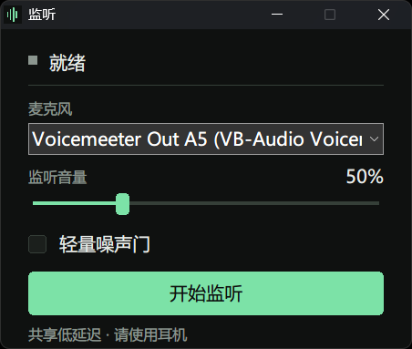

# Sidetone Lite

[简体中文](README.md) | English

A lightweight, native, low-overhead microphone sidetone tool for Windows. Select a microphone and hear yourself in real time through your headphones.



## Where it fits

- **Gaming:** Hear yourself without shouting.
- **Streaming:** Check your voice before going live.
- **Meetings:** Less “can you hear me?”
- **Voice practice:** Hear breathing, rhythm, and level in real time.
- **Multiple devices:** Quickly confirm the right microphone.

## Features

- Selectable input device; output follows the Windows default device
- Shared WASAPI audio, with the lowest driver-supported period attempted first and automatic fallback
- Adjustable 0–800% volume with smooth gain changes and soft limiting
- Optional lightweight noise gate, disabled by default
- Remembers the last microphone used successfully
- Clear notifications for device removal and default-output changes
- Single native executable of about 284 KiB, with no browser or background service

## Download

Download `SidetoneLite.exe` from [Releases](https://github.com/Fae42/sidetone-lite/releases/latest) and run it directly. No installation required.

**Use headphones, preferably wired ones.** Speakers can cause feedback, while Bluetooth audio adds latency of its own.

## Build from source

Requirements:

- Windows 10/11 x64
- MinGW-w64 g++ with C++20 support
- Windows PowerShell 5.1 or PowerShell 7+

If `g++` is not on PATH, the script also tries `tools/w64devkit/bin/g++.exe` inside the project.

```powershell
powershell -NoProfile -ExecutionPolicy Bypass -File ./build.ps1
```

Output: `dist/Jianting.exe`.

## Tests

```powershell
powershell -NoProfile -ExecutionPolicy Bypass -File ./test.ps1
```

Tests build and run entirely in the console. They do not open the monitor window or access a real microphone. Coverage includes:

- INI configuration reads, writes, and empty values
- High-ratio resampling and packet boundaries
- Ring-buffer overflow and silence padding
- Gain limiting
- Noise-gate transitions

CI runs the same build and tests on every push and pull request, then uploads the Windows x64 executable.

## Small, fast, and measurably lightweight

A native executable of about 284 KiB, with no Electron, browser, background service, or large audio framework. The event-driven audio thread works only when needed, so the tool stays focused on sidetone rather than accumulating features and overhead.

| Measured metric | Result | Why it matters |
| --- | ---: | --- |
| Executable size | About 284 KiB | Single file, no installation |
| Average CPU over 20 minutes | About 0.35% of one core | Lightweight during extended monitoring |
| Working set / private memory | About 31 MiB / 7.7 MiB | No heavyweight runtime |
| Threads / handles at completion | 6 / 330 | No sustained growth |
| Average CPU over 60 seconds at low period | About 0.42% of one core | Lower latency does not imply high overhead |

Test setup: HyperX Cloud III, 10 ms internal buffering, 100% gain, and shared WASAPI. These are local development measurements, provided only as an order-of-magnitude reference rather than a cross-hardware benchmark or performance guarantee.

## Usage and limitations

- Select a microphone and click Start. Stop monitoring before changing the input device.
- 100% represents unity gain. Higher values also amplify the noise floor, and excessive gain may sound compressed.
- End-to-end latency also depends on the Windows audio engine, drivers, and headphones; it is not the same as the period shown in the UI.
- Low-period support depends on the output driver. The status bar shows the period actually accepted.
- `Jianting.ini` is stored beside the executable and contains only the device ID. If the directory is not writable, only persistence is affected; monitoring still works.
- No recording, continuous AI denoising, virtual audio device, exclusive mode, or multi-output routing.

## Privacy

Audio is processed only in local memory. The app does not use the network, save recordings, or register itself for startup. The configuration file stores only the last successfully used microphone ID.

## Project layout

```text
src/                 Native UI, WASAPI, DSP, and INI settings
tests/               Automated tests without third-party frameworks
docs/                Design notes, research, and release notes
build.ps1            Application build script
test.ps1             Test build and runner script
.github/workflows/   Windows CI
```

## Contributing

Issues and pull requests are welcome. Read the [contribution guide](CONTRIBUTING.md) first and make sure both `./build.ps1` and `./test.ps1` pass.

## License

[MIT](LICENSE)
